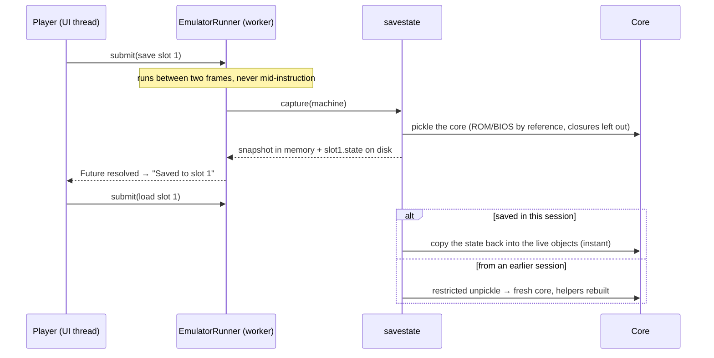
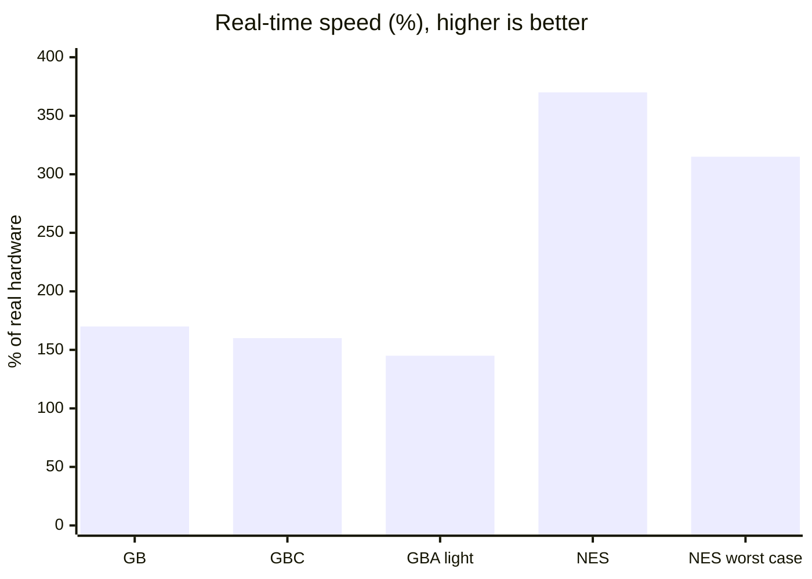
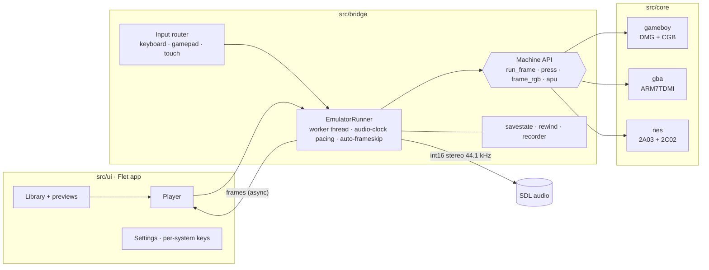

<p align="center">
  
</p>

<h1 align="center">RetroPy</h1>

<p align="center">
  <b>Game Boy · Game Boy Color · Game Boy Advance · NES · PlayStation (experimental)</b><br/>
  Four consoles emulated from scratch in pure Python, an experimental PS1 core in Rust, and a modern Flet desktop app on top.
</p>

<p align="center">
  <a href="https://github.com/abhishekbiswas772/RetroPy/actions/workflows/ci.yml"></a>
  <a href="https://github.com/abhishekbiswas772/RetroPy/actions/workflows/release.yml"></a>
  
  
  
  <a href="LICENSE"></a>
  <a href="CONTRIBUTING.md"></a>
</p>

<p align="center">
  <a href="#-quick-start">Quick start</a> ·
  <a href="#-using-the-app">Using the app</a> ·
  <a href="#-the-four-cores">Cores</a> ·
  <a href="#-controls">Controls</a> ·
  <a href="#-save-states-rewind-and-recording">Save states</a> ·
  <a href="#-speed">Speed</a> ·
  <a href="#-how-it-works">How it works</a> ·
  <a href="#-tests">Tests</a> ·
  <a href="#-faq-and-troubleshooting">FAQ</a> ·
  <a href="CONTRIBUTING.md">Contributing</a>
</p>

<p align="center">
  
</p>

<table align="center">
  <tr>
    <td align="center"><br/><sub><b>Game Boy</b>: an original scene</sub></td>
    <td align="center"><br/><sub><b>NES</b>: working through blargg's hardware tests</sub></td>
  </tr>
  <tr>
    <td align="center"><br/><sub><b>Game Boy Color</b>: CGB Acid2</sub></td>
    <td align="center"><br/><sub><b>Game Boy Advance</b>: open test ROM</sub></td>
  </tr>
</table>

<p align="center">
  <sub>Every frame above is drawn by this emulator, running open test ROMs. No commercial game is shown or shipped.
  Regenerate them yourself with <code>uv run python docs/make_media.py</code>.</sub>
</p>

---

## ✨ Highlights

- **Four cores, zero native code.** The Game Boy, Game Boy Color, GBA and NES are all written in Python, using only the standard library.
- **An experimental PlayStation core in Rust.** A 33.8 MHz MIPS CPU plus a software GPU is too much for an interpreter in Python, so the PS1 core is written in Rust and loaded through PyO3. It is optional: without Rust, everything else still works. See [PlayStation (experimental)](#-playstation-experimental).
- **Accurate where it counts.** The cores pass the nestest trace line by line, blargg's CPU, APU, PPU and MMC3 suites, Acid2, and jsmolka's GBA tests.
- **Smooth when Python is slow.** A worker thread paces itself on the audio clock. Auto-frameskip keeps the game and the sound at 100% when drawing can't keep up.
- **A real library app.**
  - Cover previews are generated automatically and replaced by your last frame after you play.
  - Four themes.
  - Each system has its own key layout.
  - Gamepads and touch controls are supported.
- **Battery saves that just work.** Each game gets its own folder under `saves/`. Saves are written atomically, about every 10 seconds and again when you quit.
- **Save states, on every core.** Four slots per game plus a resume point. Leaving a game pauses it and offers to save first. States from this session load instantly.
- **Rewind.** Hold `R` to go back up to 30 seconds.
- **Recording and instant replay.**
  - Record gameplay as **MP4 with sound** (H.264 + AAC), or as a GIF.
  - "Clip last 30s" saves what just happened, without having to be recording.
  - Both land in **Moments**, next to your screenshots.

---

## 🚀 Quick start

```bash
git clone https://github.com/abhishekbiswas772/RetroPy.git
cd RetroPy
uv sync
uv run python main.py          # opens the library
```

Drop your games into the `rom/` folders. It is git-ignored, so your ROMs never get committed.

```text
rom/
├── gb/         .gb
├── gb_color/   .gbc
├── gba/        .gba
└── nes/        .nes
```

You can also point **Settings → Paths & Saves** at a folder you already have. `~/Games/ROMs` is picked up automatically.

Saves are kept in `saves/`, which is created on first start and is git-ignored. There is one folder per console, then one per game:

```text
saves/
├── gb/    My Game/My Game.sav
├── gbc/   …
├── gba/   …
└── nes/   …
```

You can move it under **Settings → Paths & Saves → Change save folder**. An old `.sav` sitting next to a ROM is copied in automatically the first time that game loads; the original is never deleted.

<details>
<summary><b>More ways to launch</b></summary>

```bash
uv run python main.py app rom/gba/game.gba   # library, straight into a game
uv run python main.py game.nes               # lightweight pygame window
uv run python main.py run game.gba --frames 600   # headless, prints the speed
uv run python main.py info game.nes          # cartridge header
```

Paths can be relative to `rom/` (`main.py nes/game.nes`).

| Flag | Does |
|---|---|
| `--mute --scale 4` | quiet, 4× window |
| `--keys app` | desktop-app key layout inside the pygame window |
| `--dmg` | play a Color cart on the original green LCD |
| `--bios path/to/bios.bin` | optional real GBA BIOS (the built-in HLE BIOS is the default) |

</details>

Prebuilt **Windows** and **Linux** apps are attached to every [release](https://github.com/abhishekbiswas772/RetroPy/releases).

---

## 🖥 Using the app

### Library

- Every game found in your ROM folders appears as a card with a cover. Games you haven't played yet get an auto-generated preview, which is swapped for your last frame once you play.
- **Search** with `Ctrl+K`.
- **Filter** by console in the sidebar, or open **Favorites**. Sort by last played, title or system.
- **Continue playing** at the top shows your most recent game:
  - **Resume** starts it fresh from its battery save.
  - **Load resume point** / **Load slot N** opens it at its newest save state.
- **Add ROMs** opens a file picker (desktop). **Save states** in the sidebar opens your saves folder.

### Player

```text
┌ ← Library  Game title [NES]   ⏸ ⏪ ⏩ ⟲ │ 📷  ● Record  ⟲ Clip last 30s │ ⛶ ┐
│                                             ┌ Save states ────────────┐ │
│                                             │ [thumb] Slot 1 · 2m ago ● │ │
│              game screen                    │ [     ] Slot 2 · Empty    │ │
│                                             │ [ Save ]       [ Load ]   │ │
│                                             │ Resume point · 1h ago     │ │
│                                             │ Rewind: hold R · 18 s     │ │
│                                             │ Speed  1× 2× 4× 8×        │ │
│                                             └───────────────────────────┘ │
└ ● Running  60 FPS · game 100%  Slot 1  Replay buffer 30 s  ● REC          ┘
```

- **Toolbar:** pause, rewind, fast-forward, reset, screenshot, **Record** (shows a running timer while recording), **Clip last 30s**, fullscreen.
- **Save states panel:**
  - Pick a slot (1–4), then **Save** or **Load**. Each slot shows a thumbnail and how long ago it was saved.
  - The **Resume point** is the state written by **Save and leave**.
  - Below the slots: how many seconds of rewind are ready, and the speed picker.
- **Footer:** frames drawn per second next to the real game speed. With auto-frameskip, the game can run at 100% while fewer frames are drawn.
- **Leaving:** going back to the library, or to another screen from the pause menu, pauses the game and asks **Save and leave · Leave without saving · Cancel**. The game's own battery save is written either way.
- **Touch screens** get an on-screen pad. Shoulder buttons appear only for GBA.

### Moments

Screenshots (`F12`), recordings (`F10`) and clips (`F9`) collect here, newest first. Filter by **Recordings & clips** or **Screenshots**. GIFs play in the preview, and videos show a poster frame. For a selected moment you can **Export** it, **Play** it (videos) or **Copy to clipboard** (images), **Show in folder** or **Delete** it.

### Settings

| Section | What's there |
|---|---|
| **Controls** | A separate keyboard layout for each of GB, GBC, GBA, NES and PS1 (pick one under **Layout for**). Click a binding, then press a key; a key already in use moves to the new action. Also the gamepad layout and every hotkey. |
| **Audio** | Volume. Sound plays through SDL in the desktop app. |
| **Paths & saves** | ROM folders to scan, and the save folder (change it, open it, or reset it to the default). |

**Appearance** (*Themes & screen*):

- Four app themes: Daylight, Midnight, DMG Green, Berry. Optionally match the theme to the console, or follow the system's light/dark mode.
- Screen shaders: pixel-perfect, LCD grid, CRT scanlines, smooth, soft.
- Original Game Boy palettes.
- GBC/GBA LCD colour correction, integer scaling and frame blending.

### Where your files live

| What | Where |
|---|---|
| Your ROMs | `rom/gb`, `rom/gb_color`, `rom/gba`, `rom/nes`, `rom/ps1`, or any folder you add |
| Battery saves | `saves/<console>/<game>/<game>.sav` (`gb`, `gbc`, `gba`, `nes` or `ps1`) |
| Save states | `saves/<console>/<game>/states/slot<N>.state` (+ `.png` thumbnail) |
| Screenshots, recordings, clips | `~/.gba_python/moments/` |
| Settings, covers | `~/.gba_python/` (the app storage folder when packaged) |

### Feature status

| Feature | Status |
|---|---|
| GB / GBC / GBA / NES emulation, sound, gamepads, touch | ✅ |
| Battery saves (one folder per console and game) | ✅ |
| Save states: 4 slots + resume point, on all four cores | ✅ |
| Save prompt when leaving a game | ✅ |
| Rewind (30 s) | ✅ |
| Fast-forward (2×, 4×, 8×, hold `F`) | ✅ |
| Screenshots | ✅ |
| Recording and clip of the last 30 s, as MP4 with sound or GIF | ✅ |
| PlayStation: PS-X EXE programs (CPU, GPU, DMA, timers, pad) | 🧪 experimental, Rust core |
| PlayStation: save states and rewind | ✅ |
| PlayStation: 3D maths (GTE) | ✅ |
| PlayStation: CD games, memory cards | 🚧 next milestones |
| Cheats, achievements, link play | 🚧 UI preview, not in the cores yet |

---

## 🧪 PlayStation (experimental)

The PS1 core lives in [`src/core/ps1/native`](src/core/ps1/native), a Rust crate built as a Python
extension with [PyO3](https://pyo3.rs). The app talks to it through `PS1Machine`, the same `Machine`
API as every other core. The emulation loop runs in Rust and releases the GIL.

**Build it once** (needs [Rust](https://rustup.rs); on Windows also the Visual Studio Build Tools with the C++ workload):

```bash
uv run python -m src.core.ps1.build      # cargo build --release, then copies _ps1.pyd / _ps1.so into src/core/ps1/
```

Then open a PS-X EXE in the app, or try one from the command line:

```bash
uv run python main.py info tests/roms/ps1/cop/cop.exe          # EXE header
uv run python main.py run tests/roms/ps1/gp0-e1/gp0-e1.exe     # headless, prints the program's TTY output
```

Without that step the rest of the app is unchanged. PS1 games show up in the library, and opening one says how to build the core.

**What runs today: PS-X EXE programs** (`.exe` / `.psx` files starting with `PS-X EXE`). Homebrew and test programs work; commercial games need the CD-ROM milestone. Windows `.exe` files in a ROM folder are ignored, because only the PS-X header counts.

| Part | Status |
|---|---|
| R3000A CPU: load and branch delay slots, COP0 exceptions, bus errors, cache isolation | ✅ |
| Memory map, DMA (GPU, OTC, SPU, CD-ROM; block and linked list), IRQs, timers (system, dot and hblank clocks) | ✅ |
| GPU: triangles and quads (flat, Gouraud, textured 4/8/15-bit with CLUT), lines, rectangles, fills, VRAM copies, blending, mask bit, dithering | ✅ |
| Digital pad (SIO) | ✅ |
| Boot without a BIOS: a small HLE kernel (exceptions, events, TTY, `printf`, pads) | ✅ runs every bundled test |
| Boot with your own BIOS (**Settings → BIOS & firmware**), EXE sideloaded at the shell | ⚠️ implemented, not yet tested against a real BIOS |
| Save states, resume point and rewind | ✅ the Rust core serializes itself (serde + bincode, ~3.6 MB raw, ~90 KB compressed); replay after a load is bit-identical |
| CD-ROM (`.cue` / `.bin`) | 🚧 milestone 2 |
| GTE (3D maths coprocessor): all 22 commands, 44-bit MACs, flags, UNR division | ✅ 1,100/1,100 hardware fuzz cases, `gte/test-all` 1150/1150 |
| SPU (sound): 24 ADPCM voices, ADSR, sweeps, pitch modulation, noise, Gaussian interpolation, reverb, IRQ | ✅ `spu/memory-transfer` matches a console (incl. DMA timing); voice output correlates 0.999 with an independent decoder. No console recording to compare playback against. |
| MDEC (FMV decoder): RLE, IDCT, YUV→RGB, 4/8/15/24-bit, CPU and DMA | ✅ mono output exact; colour within one 5-bit step |
| Memory cards | 🚧 later |

**Accuracy.** Checked against real-console output from [JaCzekanski's ps1-tests](https://github.com/JaCzekanski/ps1-tests) (MIT). Ten of them are bundled in `tests/roms/ps1` with their hardware logs and VRAM dumps:

| Test | Result |
|---|---|
| `cpu/cop`, `cpu/code-in-io`, `dma/dpcr`, `dma/otc-test`, `gpu/gp0-e1`, `gpu/mask-bit` | ✅ console log matches |
| `gpu/rectangles`, `gpu/quad`, `gpu/transparency` | ✅ VRAM matches the console |
| `gpu/triangle` | ✅ within one 5-bit step on Gouraud colours (0.4% of pixels round differently) |
| `gpu/clut-cache`, `gpu/lines`, `gpu/texture-flip`, `gpu/uv-interpolation` (not bundled) | 98.8–99.9% of pixels |
| `cpu/access-time`, `dma/chopping`, `dma/chain-looping`, `gpu/bandwidth` | ❌ memory wait states and DMA timing aren't modelled yet |
| `mdec/4bit`, `mdec/8bit` | ✅ VRAM identical to the console |
| `mdec/frame` 15-bit (DMA) | ✅ every pixel within one 5-bit step (~80% exact); 24-bit bytes within ±3 |
| `gte/test-all` (1,150 checks) and `gte-fuzz` (1,100 commands, all 64 registers compared) | ✅ identical to the console |

**Speed.** About 220–250 emulated frames per second on the bundled tests (roughly 4× real time), measured on a laptop, including frame copies to Python.

**Buttons.** The shared layout maps onto the pad as **A → ✕**, **B → ○**, **L / R → L1 / R1**, plus Start, Select and the D-pad. △, □, L2 and R2 can be pressed from code (`PS1Machine.press_ps1`); they will get keys when games need them.

**BIOS.** Optional for EXEs. A BIOS is Sony's copyrighted firmware: the app never ships or downloads one, so dump it from your own console.

---

## 🎮 The four cores

| | Game Boy | Game Boy Color | Game Boy Advance | NES |
|---|---|---|---|---|
| **CPU** | Sharp LR35902 | same, double speed | ARM7TDMI (ARM + Thumb) | Ricoh 2A03 (6502), all 256 opcodes |
| **Picture** | 160×144, 4 shades | palettes, banks, HDMA | modes 0–5, affine, blend, mosaic | 256×240, scanline renderer, sprite-0 hit |
| **Sound** | 4-channel APU | same | PSG + Direct Sound | 2 pulse, triangle, noise, DMC |
| **Carts** | MBC1/2/3 + RTC, MBC5 | CGB header detection | SRAM, Flash 64K/128K, EEPROM, RTC | NROM, MMC1, UxROM, CNROM, AxROM, Color Dreams, GxROM, MMC3 |
| **Boot** | no boot ROM needed | auto, or `--dmg` | built-in HLE BIOS | iNES / NES 2.0 headers |

The file extension picks the core. Together, the supported NES mappers cover most of the NES library.

<details>
<summary><b>What each core covers in detail</b></summary>

**Game Boy / Color.**
- Full CPU, timer, interrupts, joypad, PPU and APU.
- Cartridges: MBC1, MBC2, MBC3 with RTC, and MBC5, with battery RAM.
- Color mode adds palettes, background attributes, VRAM and WRAM banking, HDMA and double speed.

**Game Boy Advance.**
- CPU: ARM7TDMI with ARM and Thumb, including the prefetch that self-modifying carts rely on.
- DMA and timers.
- PPU modes 0–5: text and affine backgrounds, affine sprites, windows, alpha and brightness, mosaic.
- Audio: Direct Sound plus the PSG.
- Saves are detected from the ROM: SRAM, Flash 64K/128K, EEPROM.
- Cartridge GPIO drives a Seiko S-3511 real-time clock.

**NES.**
- CPU: a generated 6502 interpreter with every official and unofficial opcode. Cycle counts match nestest exactly.
- PPU:
  - catch-up scanline renderer with cached nametable rows;
  - sprite-0 hit timed to the dot;
  - the vblank and NMI races;
  - odd-frame skip.
- APU: pulse with sweep, triangle, noise LFSR, DMC with its sample buffer and IRQ, and a 4/5-step frame sequencer with the frame IRQ.
- MMC3 scanline IRQ, clocked from PPU A12.

</details>

---

## 🕹 Controls

| Button | Desktop app | Play window | Gamepad |
|---|---|---|---|
| D-pad | WASD / arrows | Arrows | D-pad or left stick |
| A / B | K / J | X / Z | A / B |
| L / R *(GBA)* | Q / E | A / S | LB / RB or triggers |
| Start | Enter | Enter | Menu |
| Select | Backspace | Right Shift / Backspace | View |

| Hotkey (desktop app) | Default |
|---|---|
| Fast-forward (hold) | `F` |
| Rewind (hold) | `R` |
| Pause / resume | `P` |
| Quick save / quick load (current slot) | `F1` / `F4` |
| Previous / next slot | `[` / `]` |
| Clip the last 30 s | `F9` |
| Start / stop recording | `F10` |
| Fullscreen | `F11` |
| Screenshot | `F12` |

GB, GBC, GBA and NES each keep their **own** layout under **Settings → Controls**, and every hotkey can be rebound there. Keyboard, Xbox / PlayStation / Switch-style pads, and the on-screen touch pad all feed one input router. Taps shorter than a frame still register.

---

## 💾 Save states, rewind and recording

Save states and battery saves live together in the game's folder:

```text
saves/nes/My Game/
├── My Game.sav            battery save (what the game itself saves)
└── states/
    ├── slot0.state        resume point ("Save and leave")
    ├── slot1.state        quick-save slots 1–4
    └── slot1.png          thumbnail shown in the Saves panel
```

| Feature | How it works |
|---|---|
| **Save states** | The whole core is pickled, minus the ROM and BIOS, so a state is only a few KB to a few tens of KB. A state saved this session reloads instantly, straight into the running game. A state from an earlier session loads into a fresh core. |
| **Safe loading** | States load with a restricted unpickler that only allows the emulator's own classes, so a shared `.state` file can't run code. A state from another game or console is refused. |
| **Leaving a game** | The game pauses and asks: **Save and leave**, **Leave without saving**, or **Cancel**. **Continue playing** in the library then offers **Load resume point**. |
| **Rewind** | A snapshot is taken every 6 frames and kept for 30 s, compressed in memory. Holding rewind walks back about 3× faster than real time, with the sound muted. |
| **Recording** | Picture (30 fps) and game sound are compressed as they arrive, both tagged with game time, so they stay in sync even with frameskip or fast-forward. When you stop, a background thread encodes an **MP4** (H.264 + AAC, scaled up to about 720 lines with sharp pixels) or a silent **GIF**. Pick the format under **Record as** in the player. MP4 encoding uses PyAV, whose wheels include FFmpeg, so there is nothing else to install. |
| **Clip last 30s** | A rolling 30 s replay buffer (can be turned off in the player). Saving a clip never interrupts the game. |



Rewind and the replay buffer cost about 2% of frame time on GB and GBA, and about 9% on NES, which has roughly 3× headroom.

The features live in `src/bridge/savestate/`, `src/bridge/rewind/` and `src/bridge/recorder/`. The cores' side is in `src/core/adaptors/`:

- `snapshot/` is how a core marks the helpers that can't be pickled (generated opcode closures, memoryviews, code caches) and rebuilds them after a load.
- `saves/` decides where battery saves go.

---

## ⚡ Speed

Pure Python, measured with `docs/make_media.py` on a laptop. Results are in [`docs/benchmark.json`](docs/benchmark.json).

| Core | Frames/s, drawing every frame | Frames/s, frameskip | Real time |
|---|---:|---:|---:|
| Game Boy | ~104 | ~146 | **~170%** |
| Game Boy Color | ~97 | ~144 | **~160%** |
| Game Boy Advance, light scene | ~87 | ~90 | **~145%** |
| NES | ~225 | ~262 | **~370%** |
| NES, synthetic worst case | ~189 | ~296 | **~315%** |

The NES worst case is a full screen of random tiles, 64 sprites, scrolling every frame, OAM DMA and a busy CPU.

Heavy GBA scenes, with lots of blending plus Direct Sound, drop to about 50–60% drawn. Auto-frameskip then keeps the game and the audio at full speed and draws about 20–30 fps.



---

## 🧠 How it works



<details>
<summary><b>Why it's fast enough in Python</b></summary>

- **Generated interpreters.** The 6502 loop is written once as source and compiled with `exec`. Registers live in local variables, dispatch is a binary `if` tree over the opcode, and RAM/ROM reads are inlined.
- **Catch-up timing.** The CPU runs until the next point where something must happen on time: an end of line, vblank, an MMC3 clock or an APU IRQ. The PPU and APU then catch up, and register accesses sync them to the exact cycle.
- **Scanline rendering with caches.** Background rows are cached by (tiles, attributes, fine Y, CHR banks), so static screens cost almost nothing.
- **Frameskip that doesn't cheat.** `run_frame(render=False)` still runs everything except drawing. Timing, sprite-0 hits and sound are identical.
- **Audio-clocked pacing.** The runner keeps about 95 ms of sound queued. When the queue drops below 60 ms it skips drawing (up to 3 frames in a row) instead of letting the audio crackle.

</details>

<details>
<summary><b>Project layout</b></summary>

```text
main.py                  launcher and flet build entry
src/core/gameboy/        DMG and CGB
src/core/gba/            ARM, PPU, APU, DMA, timers, HLE BIOS, RTC
src/core/nes/            6502 CPU, PPU, APU, mappers, cartridge
src/core/ps1/            experimental PS1 core: Python wrapper + build helper
src/core/ps1/native/     the Rust crate (CPU, GPU, DMA, timers, pad, HLE kernel)
src/core/adaptors/saves/     where battery saves live (per console, per game)
src/core/adaptors/snapshot/  save-state hooks the cores implement
src/bridge/              Machine API, EmulatorRunner, keyboard / gamepad / touch adaptors
src/bridge/savestate/    save states: in-memory snapshots, state files, slots
src/bridge/rewind/       rewind ring buffer
src/bridge/recorder/     MP4 (with sound) / GIF recording and the 30 s replay buffer
src/ui/                  Flet app (library, player, settings, themes)
tests/roms/              open test ROMs: blargg, Acid2, jsmolka, nes-test-roms, ps1-tests
docs/                    README media and make_media.py
rom/                     yours, git-ignored
saves/                   battery saves, one folder per console and game (git-ignored)
```

Settings, thumbnails and screenshots are stored in `~/.gba_python` while you develop, and in the app storage directory once packaged.

</details>

---

## 🧪 Tests

```bash
uv run python -m pytest -q             # fast suite: unit tests, nestest, GBA test ROMs
uv run python -m pytest -q --slow      # + blargg (GB and NES), Acid2, MMC3, APU, sprite hit
uv run python -m tests.run_tests       # Game Boy blargg speed report
```

| Suite | Status |
|---|---|
| nestest (8,991 traced instructions) | ✅ exact match |
| blargg NES: `instr_test`, `instr_timing`, `branch_timing`, `cpu_timing` | ✅ |
| blargg NES: `apu_test` (8/8), sprite hit (8/8), PPU memory, `vbl_clear_time` | ✅ |
| blargg MMC3 IRQ: clocking, details, A12 | ✅ (scanline timing: in progress) |
| blargg `ppu_vbl_nmi` | 9/10 (even/odd frame timing in progress) |
| blargg Game Boy `cpu_instrs`, DMG Acid2, CGB Acid2, jsmolka GBA | ✅ |
| ps1-tests (10 bundled; skipped when the PS1 core isn't built) | ✅ see [PlayStation](#-playstation-experimental) |

Commercial carts are optional, and those tests are skipped when `rom/` is empty. They run from a temporary copy, so a real `.sav` is never touched.

---

## 📦 Build

```bash
flet build windows
flet build linux
```

Push a tag like `v0.2.0` and GitHub Actions builds both apps and publishes them to a release. CI runs the test suite on Linux with a real X11 server and PulseAudio.

---

## 🧭 Honest limits

- Cheats, achievements and link play are UI previews for now; the cores don't implement them yet.
- The PS1 core is experimental: PS-X EXE programs only. Booting through a real BIOS is implemented but untested. CI builds and tests it, and the release installers include it.
- Sound uses SDL through pygame, so it works in the desktop app only.
- The NES core is NTSC only. PAL and mappers beyond the ones listed above are welcome contributions.

---

## ❓ FAQ and troubleshooting

<details>
<summary><b>Where do I get games?</b></summary>

From cartridges you own: dump them with a cartridge reader. This project doesn't ship or link to ROMs. Homebrew and the open test ROMs in `tests/roms/` are a good way to try it.
</details>

<details>
<summary><b>Will a save state from an older version still load?</b></summary>

Each state records a format version and the ROM it came from, and both are checked on load. If a core's internals change a lot between versions, an old state may be refused. The game's own battery save is never affected.
</details>

<details>
<summary><b>Is it safe to load a .state file someone sent me?</b></summary>

States load with a restricted unpickler that only rebuilds the emulator's own classes, and anything else in the file is refused before it can run. The test suite includes a malicious state to check this.
</details>

<details>
<summary><b>The FPS counter says 30, but the game feels full speed.</b></summary>

That's auto-frameskip. The footer shows *frames drawn* and *game speed* separately. When drawing can't keep up, as in heavy GBA scenes, the game and its sound still run at 100% and fewer frames are drawn.
</details>

<details>
<summary><b>No sound.</b></summary>

Sound needs SDL through pygame, which `uv sync` installs on desktop. Check the volume in the player's side panel or under **Settings → Audio**, and that your output device works in other apps.
</details>

<details>
<summary><b>My keys work for one console but not another.</b></summary>

Each console has its own layout. Open **Settings → Controls**, pick the console under **Layout for**, and rebind there.
</details>

---

## 🤝 Contributing

Bug reports, test-ROM results and pull requests are all welcome. See [CONTRIBUTING.md](CONTRIBUTING.md) for the setup, the project conventions, and how to add a mapper or a test.

## ⚖️ License and legal

The code is released under the [MIT License](LICENSE).


This project does not include, distribute or link to copyrighted ROMs or a Nintendo BIOS. Play games you own. The GBA core boots from a built-in high-level BIOS; a real BIOS dump is optional and never shipped.

The bundled test ROMs keep their authors' terms:

- CGB/DMG Acid2: MIT, Matt Currie.
- GBA tests: MIT, jsmolka.
- The blargg Game Boy and NES tests and nestest come from the community [nes-test-roms](https://github.com/christopherpow/nes-test-roms) collection.

Silkscreen, Outfit and JetBrains Mono keep their own font licenses. "Game Boy", "NES" and related names are trademarks of Nintendo. This project is not affiliated with or endorsed by Nintendo.
