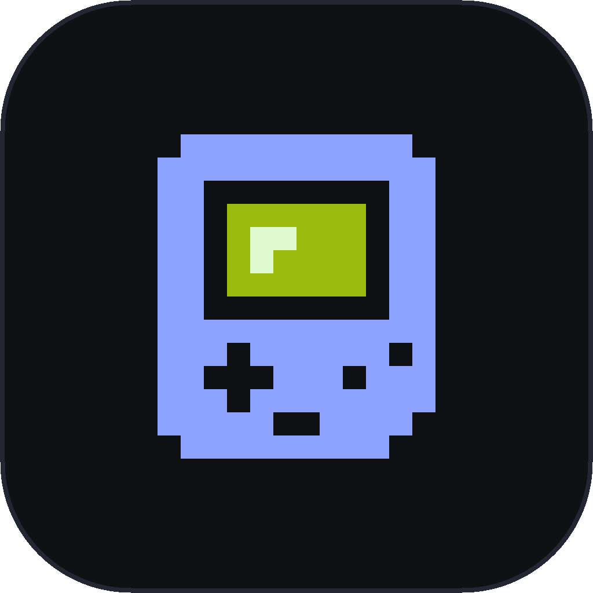
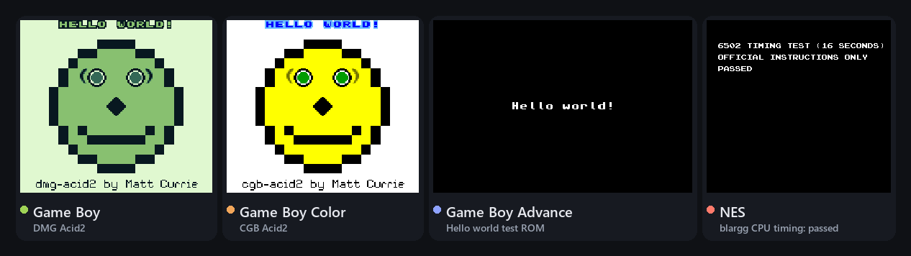
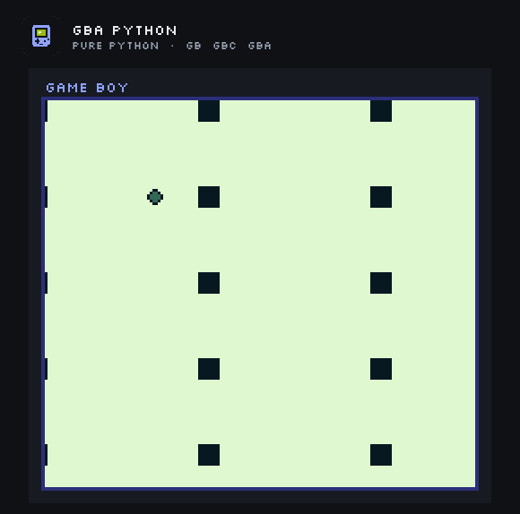
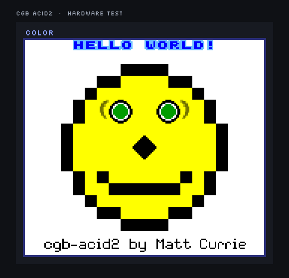
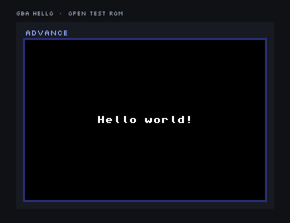
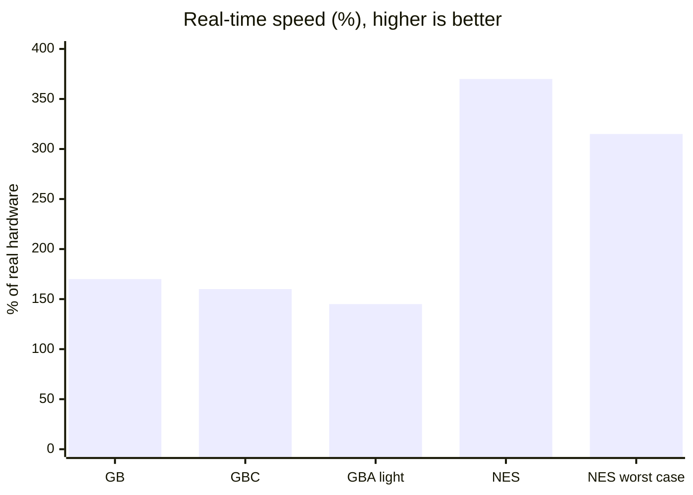
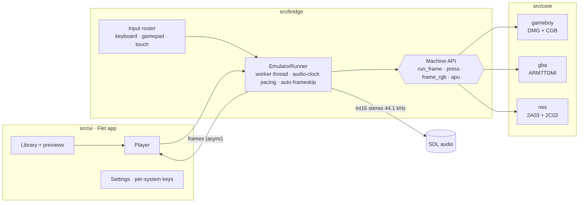

<p align="center">
  
</p>

<h1 align="center">GBA Python</h1>

<p align="center">
  <b>Game Boy · Game Boy Color · Game Boy Advance · NES</b><br/>
  Four consoles emulated from scratch in pure Python, with a modern Flet desktop app on top.
</p>

<p align="center">
  <a href="https://github.com/abhishekbiswas772/GBA_Python/actions/workflows/ci.yml"></a>
  <a href="https://github.com/abhishekbiswas772/GBA_Python/actions/workflows/release.yml"></a>
  
  
  
  <a href="CONTRIBUTING.md"></a>
</p>

<p align="center">
  <a href="#-quick-start">Quick start</a> ·
  <a href="#-the-four-cores">Cores</a> ·
  <a href="#-controls">Controls</a> ·
  <a href="#-speed">Speed</a> ·
  <a href="#-how-it-works">How it works</a> ·
  <a href="#-tests">Tests</a> ·
  <a href="CONTRIBUTING.md">Contributing</a>
</p>

<p align="center">
  
</p>

<table align="center">
  <tr>
    <td align="center"><br/><sub><b>Game Boy</b>: an original scene</sub></td>
    <td align="center"><br/><sub><b>NES</b>: working through blargg's hardware tests</sub></td>
  </tr>
  <tr>
    <td align="center"><br/><sub><b>Game Boy Color</b>: CGB Acid2</sub></td>
    <td align="center"><br/><sub><b>Game Boy Advance</b>: open test ROM</sub></td>
  </tr>
</table>

<p align="center">
  <sub>Every frame above is drawn by this emulator, running open test ROMs. No commercial game is shown or shipped.
  Regenerate them yourself with <code>uv run python docs/make_media.py</code>.</sub>
</p>

---

## ✨ Highlights

- **Four cores, zero native code.** The Game Boy, Game Boy Color, GBA and NES are all written in Python, using only the standard library.
- **Accurate where it counts.** The cores pass the nestest trace line by line, blargg's CPU, APU, PPU and MMC3 suites, Acid2, and jsmolka's GBA tests.
- **Smooth when Python is slow.** A worker thread paces itself on the audio clock. Auto-frameskip keeps the game and the sound at 100% when drawing can't keep up.
- **A real library app.**
  - Cover previews are generated automatically and replaced by your last frame after you play.
  - Four themes.
  - Each system has its own key layout.
  - Gamepads and touch controls are supported.
- **Battery saves that just work.** They are written atomically next to the ROM, about every 10 seconds and again when you quit.

---

## 🚀 Quick start

```bash
git clone https://github.com/abhishekbiswas772/GBA_Python.git
cd GBA_Python
uv sync
uv run python main.py          # opens the library
```

Drop your games into the `rom/` folders. It is git-ignored, so your ROMs never get committed.

```text
rom/
├── gb/         .gb
├── gb_color/   .gbc
├── gba/        .gba
└── nes/        .nes
```

You can also point **Settings → Paths & Saves** at a folder you already have. `~/Games/ROMs` is picked up automatically.

<details>
<summary><b>More ways to launch</b></summary>

```bash
uv run python main.py app rom/gba/game.gba   # library, straight into a game
uv run python main.py game.nes               # lightweight pygame window
uv run python main.py run game.gba --frames 600   # headless, prints the speed
uv run python main.py info game.nes          # cartridge header
```

Paths can be relative to `rom/` (`main.py nes/game.nes`).

| Flag | Does |
|---|---|
| `--mute --scale 4` | quiet, 4× window |
| `--keys app` | desktop-app key layout inside the pygame window |
| `--dmg` | play a Color cart on the original green LCD |
| `--bios path/to/bios.bin` | optional real GBA BIOS (the built-in HLE BIOS is the default) |

</details>

Prebuilt **Windows** and **Linux** apps are attached to every [release](https://github.com/abhishekbiswas772/GBA_Python/releases).

---

## 🎮 The four cores

| | Game Boy | Game Boy Color | Game Boy Advance | NES |
|---|---|---|---|---|
| **CPU** | Sharp LR35902 | same, double speed | ARM7TDMI (ARM + Thumb) | Ricoh 2A03 (6502), all 256 opcodes |
| **Picture** | 160×144, 4 shades | palettes, banks, HDMA | modes 0–5, affine, blend, mosaic | 256×240, scanline renderer, sprite-0 hit |
| **Sound** | 4-channel APU | same | PSG + Direct Sound | 2 pulse, triangle, noise, DMC |
| **Carts** | MBC1/2/3 + RTC, MBC5 | CGB header detection | SRAM, Flash 64K/128K, EEPROM, RTC | NROM, MMC1, UxROM, CNROM, AxROM, Color Dreams, GxROM, MMC3 |
| **Boot** | no boot ROM needed | auto, or `--dmg` | built-in HLE BIOS | iNES / NES 2.0 headers |

The file extension picks the core. Together, the supported NES mappers cover most of the NES library.

<details>
<summary><b>What each core covers in detail</b></summary>

**Game Boy / Color.**
- Full CPU, timer, interrupts, joypad, PPU and APU.
- Cartridges: MBC1, MBC2, MBC3 with RTC, and MBC5, with battery RAM.
- Color mode adds palettes, background attributes, VRAM and WRAM banking, HDMA and double speed.

**Game Boy Advance.**
- CPU: ARM7TDMI with ARM and Thumb, including the prefetch that self-modifying carts rely on.
- DMA and timers.
- PPU modes 0–5: text and affine backgrounds, affine sprites, windows, alpha and brightness, mosaic.
- Audio: Direct Sound plus the PSG.
- Saves are detected from the ROM: SRAM, Flash 64K/128K, EEPROM.
- Cartridge GPIO drives a Seiko S-3511 real-time clock.

**NES.**
- CPU: a generated 6502 interpreter with every official and unofficial opcode. Cycle counts match nestest exactly.
- PPU:
  - catch-up scanline renderer with cached nametable rows;
  - sprite-0 hit timed to the dot;
  - the vblank and NMI races;
  - odd-frame skip.
- APU: pulse with sweep, triangle, noise LFSR, DMC with its sample buffer and IRQ, and a 4/5-step frame sequencer with the frame IRQ.
- MMC3 scanline IRQ, clocked from PPU A12.

</details>

---

## 🕹 Controls

| Button | Desktop app | Play window | Gamepad |
|---|---|---|---|
| D-pad | WASD / arrows | Arrows | D-pad or left stick |
| A / B | K / J | X / Z | A / B |
| L / R *(GBA)* | Q / E | A / S | LB / RB or triggers |
| Start | Enter | Enter | Menu |
| Select | Backspace | Right Shift / Backspace | View |
| Fast-forward | F | | |

GB, GBC, GBA and NES each keep their **own** layout under **Settings → Controls**. Keyboard, Xbox / PlayStation / Switch-style pads, and the on-screen touch pad all feed one input router. Taps shorter than a frame still register.

---

## ⚡ Speed

Pure Python, measured with `docs/make_media.py` on a laptop. Results are in [`docs/benchmark.json`](docs/benchmark.json).

| Core | Frames/s, drawing every frame | Frames/s, frameskip | Real time |
|---|---:|---:|---:|
| Game Boy | ~104 | ~146 | **~170%** |
| Game Boy Color | ~97 | ~144 | **~160%** |
| Game Boy Advance, light scene | ~87 | ~90 | **~145%** |
| NES | ~225 | ~262 | **~370%** |
| NES, synthetic worst case | ~189 | ~296 | **~315%** |

The NES worst case is a full screen of random tiles, 64 sprites, scrolling every frame, OAM DMA and a busy CPU.

Heavy GBA scenes, with lots of blending plus Direct Sound, drop to about 50–60% drawn. Auto-frameskip then keeps the game and the audio at full speed and draws about 20–30 fps.



---

## 🧠 How it works



<details>
<summary><b>Why it's fast enough in Python</b></summary>

- **Generated interpreters.** The 6502 loop is written once as source and compiled with `exec`. Registers live in local variables, dispatch is a binary `if` tree over the opcode, and RAM/ROM reads are inlined.
- **Catch-up timing.** The CPU runs until the next point where something must happen on time: an end of line, vblank, an MMC3 clock or an APU IRQ. The PPU and APU then catch up, and register accesses sync them to the exact cycle.
- **Scanline rendering with caches.** Background rows are cached by (tiles, attributes, fine Y, CHR banks), so static screens cost almost nothing.
- **Frameskip that doesn't cheat.** `run_frame(render=False)` still runs everything except drawing. Timing, sprite-0 hits and sound are identical.
- **Audio-clocked pacing.** The runner keeps about 95 ms of sound queued. When the queue drops below 60 ms it skips drawing (up to 3 frames in a row) instead of letting the audio crackle.

</details>

<details>
<summary><b>Project layout</b></summary>

```text
main.py                  launcher and flet build entry
src/core/gameboy/        DMG and CGB
src/core/gba/            ARM, PPU, APU, DMA, timers, HLE BIOS, RTC
src/core/nes/            6502 CPU, PPU, APU, mappers, cartridge
src/bridge/              Machine API, EmulatorRunner, keyboard / gamepad / touch adaptors
src/ui/                  Flet app (library, player, settings, themes)
tests/roms/              open test ROMs: blargg, Acid2, jsmolka, nes-test-roms
docs/                    README media and make_media.py
rom/                     yours, git-ignored
```

Settings, thumbnails and screenshots are stored in `~/.gba_python` while you develop, and in the app storage directory once packaged.

</details>

---

## 🧪 Tests

```bash
uv run python -m pytest -q             # fast suite: unit tests, nestest, GBA test ROMs
uv run python -m pytest -q --slow      # + blargg (GB and NES), Acid2, MMC3, APU, sprite hit
uv run python -m tests.run_tests       # Game Boy blargg speed report
```

| Suite | Status |
|---|---|
| nestest (8,991 traced instructions) | ✅ exact match |
| blargg NES: `instr_test`, `instr_timing`, `branch_timing`, `cpu_timing` | ✅ |
| blargg NES: `apu_test` (8/8), sprite hit (8/8), PPU memory, `vbl_clear_time` | ✅ |
| blargg MMC3 IRQ: clocking, details, A12 | ✅ (scanline timing: in progress) |
| blargg `ppu_vbl_nmi` | 9/10 (even/odd frame timing in progress) |
| blargg Game Boy `cpu_instrs`, DMG Acid2, CGB Acid2, jsmolka GBA | ✅ |

Commercial carts are optional, and those tests are skipped when `rom/` is empty. They run from a temporary copy, so a real `.sav` is never touched.

---

## 📦 Build

```bash
flet build windows
flet build linux
```

Push a tag like `v0.2.0` and GitHub Actions builds both apps and publishes them to a release. CI runs the test suite on Linux with a real X11 server and PulseAudio.

---

## 🧭 Honest limits

- Save states, rewind, video, clips, cheats, achievements and link play have buttons in the UI, but the cores don't snapshot yet. The buttons say so.
- Sound uses SDL through pygame, so it works in the desktop app only.
- The NES core is NTSC only. PAL and mappers beyond the ones listed above are welcome contributions.

---

## 🤝 Contributing

Bug reports, test-ROM results and pull requests are all welcome. See [CONTRIBUTING.md](CONTRIBUTING.md) for the setup, the project conventions, and how to add a mapper or a test.

## ⚖️ Legal

This project does not include, distribute or link to copyrighted ROMs or a Nintendo BIOS. Play games you own. The GBA core boots from a built-in high-level BIOS; a real BIOS dump is optional and never shipped.

The bundled test ROMs keep their authors' terms:

- CGB/DMG Acid2: MIT, Matt Currie.
- GBA tests: MIT, jsmolka.
- The blargg Game Boy and NES tests and nestest come from the community [nes-test-roms](https://github.com/christopherpow/nes-test-roms) collection.

Silkscreen, Outfit and JetBrains Mono keep their own font licenses. "Game Boy", "NES" and related names are trademarks of Nintendo. This project is not affiliated with or endorsed by Nintendo.
